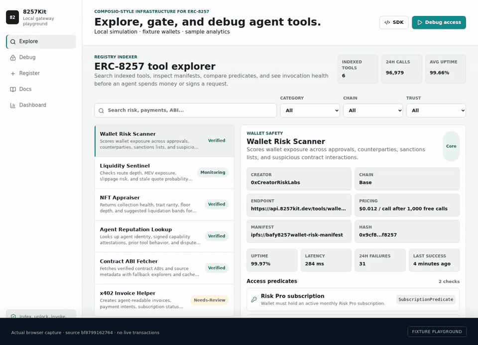

# 8257-tools

## Browser demo



[Watch the MP4](docs/demo/gateway.mp4) · [Recording provenance and verification](docs/demo/README.md)

Actual frontend capture: discover tools, explain access, simulate an invocation and stage a manifest. Fixture wallets and sample analytics; no live blockchain or payment actions.

8257Kit is a Vite + React MVP for an ERC-8257 gateway: a Composio-style integration layer for onchain AI-agent tools.

This is a local playground using fixture wallets and tool metadata. Invocations simulate access checks and responses; they do not send network requests, sign wallet messages, charge payments, or write to a blockchain. Dashboard metrics are sample data.

## Product surface

- `/explore` indexes ERC-8257 tools with manifests, predicates, pricing, trust, uptime, and health.
- `/debug` explains wallet access failures and simulates gateway invocation.
- `/register` generates a tool manifest and stages a predicate-backed registration payload.
- `/docs` shows SDK, CLI, and MCP-to-8257 examples.
- `/dashboard` surfaces creator analytics, revenue, logs, and failed access attempts.

## Commands

```bash
npm ci
npm run dev
npm run lint
npm run test
npm run build
npx playwright install chromium
npm run e2e
```

Run the full verification suite:

```bash
npm run check
```
